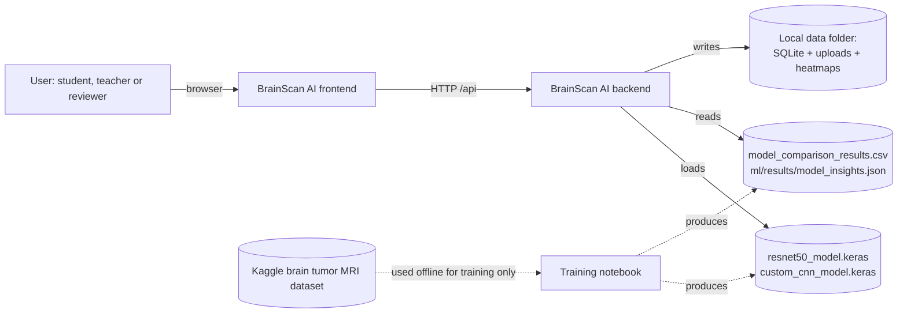
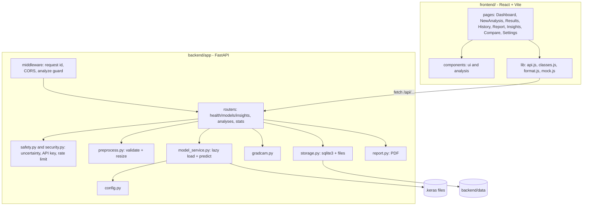
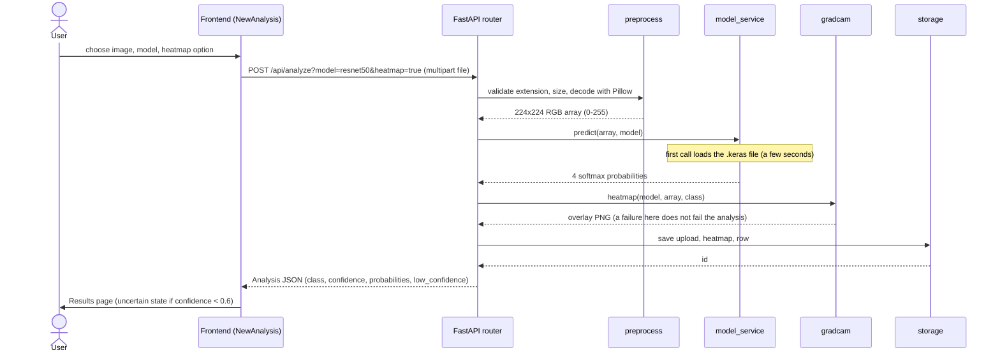
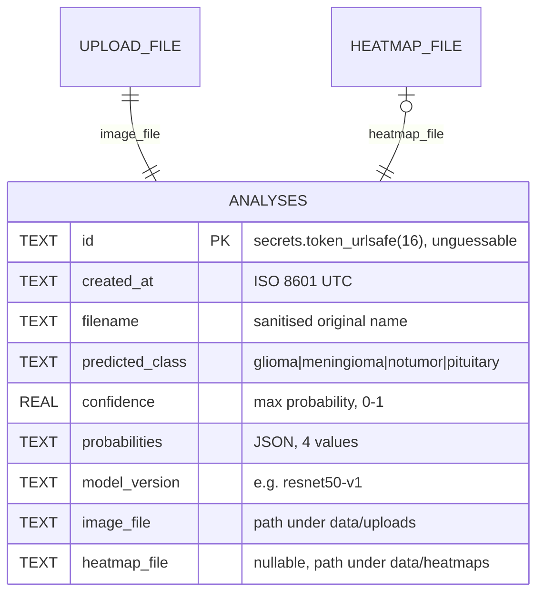
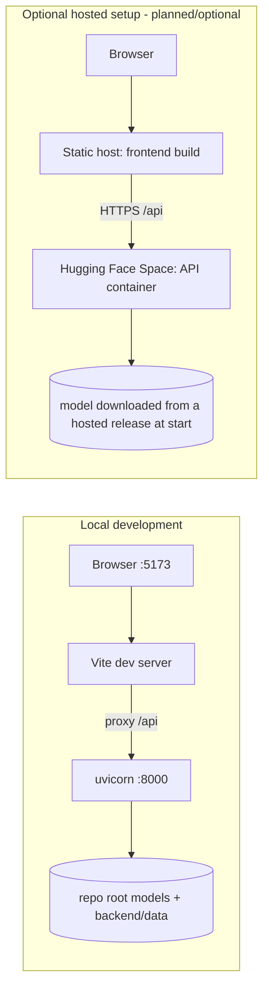

# BrainScan AI - Architecture

BrainScan AI is an educational web application that classifies a brain MRI slice into one of four classes (glioma, meningioma, notumor, pituitary), shows a Grad-CAM heatmap, and keeps a local history with PDF reports. The ML models come from the notebook `Brain_Tumor_Classification_AML.ipynb`; the web application (React frontend and FastAPI backend) wraps them. The HTTP interface is specified in `API_CONTRACT.md`; this document explains how the parts fit together.

## 1. System context

The dataset is never part of the running system. Nothing is sent to third-party services: uploads stay on the machine that runs the backend.

## 2. Components

Design points:

- The frontend only talks to `/api/...` with relative URLs. In development the Vite dev server proxies `/api` to `http://127.0.0.1:8000`.
- The API starts and `/api/health` answers even without TensorFlow. Models load lazily on the first analysis, so a missing model gives a clear `503` instead of a crash at startup.
- `lib/mock.js` provides a demo mode so the UI can be shown without a backend; demo results are marked with a badge.
- The saved models embed their own preprocessing (`Rescaling(1/255)` in the custom CNN, ResNet50 `preprocess_input` in a Lambda layer). The backend therefore only converts to RGB and resizes to 224x224 and feeds raw 0-255 values.

## 3. Analyze-request sequence

Before the router runs, `AnalyzeGuardMiddleware` can reject a request early (`413` oversize, `429` rate limit per client IP); `401` is returned for a bad key when `API_KEY` is set. `model=both` runs both models and adds a `comparison` object. Error paths: `400` unreadable, empty or corrupt file or bad parameter; `401`; `413` too large (more than 10 MB by default, `MAX_UPLOAD_MB`); `415` wrong type; `429` too many requests; `503` model unavailable. All errors have the shape `{"detail": "..."}`.

## 4. Data model of stored analyses

Implemented in `backend/app/storage.py` (SQLite table `analyses`, plus files on disk). Schema version 2 adds the columns `low_confidence`, `confidence_threshold`, `top2`, `entropy`, `model_id` and `comparison`; older rows are upgraded when the database is opened (`test_legacy_rows_are_upgraded`). The diagram below shows the original core columns.

Deleting an analysis removes the row and both files. An index on `created_at DESC` serves the history list. `DELETE /api/analyses?confirm=true` purges everything, and `RETENTION_DAYS` (default 0, keep) purges old records at startup.

## 5. Deployment view

Details, commands and trade-offs are in `DEPLOYMENT.md`. The hosted option has not been deployed by the team; it is a documented route, not a running service.

## 6. Module ownership map

| Area | Path | Owner (see TEAM.md) |
|---|---|---|
| Notebook, training, saved models, metrics CSV | `Brain_Tumor_Classification_AML.ipynb`, `*.keras`, `model_comparison_results.csv`, `ml/` | Soham |
| Backend API | `backend/` | Mayur |
| Frontend | `frontend/` | Mayur |
| Documentation, CI, delivery | `docs/`, `.github/`, `presentation/` | shared; see TEAM.md |

Git history is the source of truth for who changed what.

## 7. Technology choices and reasons

| Choice | Reason |
|---|---|
| TensorFlow/Keras | The notebook and saved `.keras` files already use it; Keras 3 (TensorFlow 2.16 or newer) is needed to load them. |
| ResNet50 transfer learning | Pretrained features help with a small dataset (5,600 training images); see METHODOLOGY.md. |
| FastAPI | Typed request handling, automatic `/docs` page, simple multipart upload, easy to test with `TestClient`. |
| SQLite (`sqlite3`) + files | Zero-setup, single-user, local storage that matches the privacy stance (nothing leaves the machine). Not meant for concurrent multi-user use. |
| Pillow | Verifies that an upload really decodes as PNG or JPEG, so a renamed text file is rejected. |
| reportlab | Pure-Python PDF generation, no system dependencies. |
| React + Vite | Fast dev loop, simple static build that any static host can serve. |
| react-router-dom | Client-side routes such as `/results/:id` and `/compare`. |
| Recharts | Charts for dashboard and model comparison. |
| lucide-react | Icon set. |
| pytest + FastAPI TestClient with a fake model service | Backend tests run without TensorFlow, so CI stays light. |

## 8. Known architectural limits

- Single-user: there are no accounts and no multi-tenant isolation. An optional shared `API_KEY` (header `X-API-Key`) and a per-IP rate limit exist, but anyone with the key can read every stored analysis. Do not expose the API publicly with real patient data.
- Run a single backend worker: the rate limiter and the model cache are in memory.
- Analyses are stored in one SQLite file on the host; hosted free tiers may have ephemeral disks.
- The 93.6 MB ResNet50 file is above GitHub's 50 MB soft warning and below its 100 MB hard block, so it needs care (see `DEPLOYMENT.md`).
